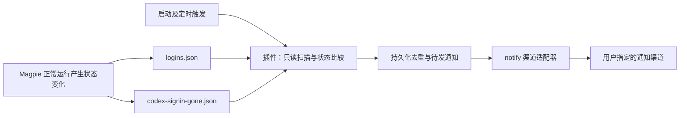

# Magpie Codex 账号提醒：被动读取现有状态的纯插件方案

状态：设计 v3.2，已实现为独立插件 0.1.0；只采用定时只读扫描。Docker 实际部署待用户环境验证。日期：2026-11-07。

约束：只安装插件，不改 Magpie 核心，不部署独立监控服务；仅定时只读指定文件，不监听目录或文件、不遍历目录；采集不调用 CLI，不请求供应商，不触发额度读取或 token 刷新。

源码基线：Magpie `8cbaeecae976d2a8561293c1abc5daf6aa89d77f`；社区插件 `8163be365f1261ded6148ba37f29ffa9e319f0e4`。用户已确认使用 Docker；实际镜像版本及数据卷类型尚未确认。

## 1. 结论

**存在可行的纯插件路线：Bun 后台插件只读 Magpie 已经落盘的账号状态，以 logins.json 中的 lapsed 为主信号，再复用 notify 的渠道发送提醒。**

目标精确定义为：“Magpie 已将某个 Codex 账号记录为需要重新登录时，通知用户。”它不主动验证厂商端登录，不保证发现 Magpie 尚未发现的撤销，也不把没有失效标记解释为账号实时可用。

这次方案替换 v2 的 CLI 轮询路线。之前把 logins.json 限定为原型过于保守：对于“通知已有失效标记”的目标，它可以作为主要来源；不能宣称它等价于完整、实时的认证状态 API。

## 2. 状态来源对比

| 来源 | 是否会主动访问上游/续期 | 可用内容 | 结论 |
| --- | --- | --- | --- |
| 直接读取 `<input.directory>/logins.json` | 文件读取不会 | 每账号 id、agent、user、on、paused、lapsed、refused 等 | 首选，观察 Magpie 已记录的失效标记 |
| 直接读取 `codex-signin-gone.json` | 文件读取不会 | Codex 目录 → 被拒 refresh token 的哈希 | 补充信号，不能只看条目存在就断言当前失效 |
| `GET /api/providers?last=1`，不带 wait | 该分支直接返回缓存，不重建供应商状态 | 缓存内 account.logins[].lapsed | 只适合已有管理服务的辅助读取，可能长期陈旧 |
| 缓存目录的 `providers-state.json` | 文件读取不会 | 与上项同源的供应商快照，含版本 | 可供显示与辅助核对，不做唯一监控来源 |
| `GET /api/providers` 普通请求 | 可能，通过 FetchNewBehind 获取模型列表 | 合成后的供应商/账号状态 | 不满足严格被动要求；不能因为是 GET 就认为无副作用 |
| `GET /v1/magpie/quotas?kept=1` | 设计为不询问厂商的缓存读取 | 配额、错误、读数时间，没有独立 lapsed 字段 | 不用错误文案重建登录状态 |
| `/v1/magpie/route-events` SSE | 路由事件观察本身不触发认证 | 请求/尝试阶段、状态码、供应商，无账号身份和认证状态 | 不是逐账号登录事件来源 |
| 页面插件 `magpie.read("providers:list")` | 文档提供受限读取 | 供应商 id 和名字，不提供账号/登录信息 | 不足以满足需求 |
| `magpie accounts codex --json` | 会读取额度，条件满足时续期 | 账号与额度 | 排除 |

没有在本次检查的 notify、mail-watch 中发现已经实现 Codex 账号状态监听的可直接安装功能；可以复用它们的发送模块或文件监控思路。

## 3. 为什么 logins.json 可作为主来源

文件格式是账号数组，Codex 行的 agent 为 codex。它包含认证数据，也包含核心已经做出的状态判定。

已追踪的状态路径：

1. **保存账号的刷新被拒绝**：`savedRefreshFailed` 写入该账号的 Lapsed，并调用 writeLogins。
2. **请求使用的凭据被确认撤销**：`markRevoked` 写入 Lapsed 和 `Refused = revoked:<credential mark>`，经 editSideLogin → writeLogins 落盘。
3. **Codex 当前账号或其他目录账号的额度读取确认失效**：`codexSignInRead` 将需要记录的失败导向 markRevoked；并不只有备用账号会被标记。
4. **请求成功/失效标记解除**：`ServedSignIn` 清除相应 Lapsed/Refused 并写回。保存账号正常续期成功也会清除 Lapsed。
5. **重新登录**：addLogin/upsertLogin 更新凭据；相同旧凭据的撤销标记保留，换成新凭据时可清除。插件等待落盘结果，不参与这些动作。

Magpie 原有测试覆盖当前账号与保存账号被标记、重新登录清除、刷新后仍被拒绝等场景；这些原有测试仅作源码审阅，未运行。独立插件的隔离测试另见下文。

因此，A 账号失效后网关转给 B 且最终请求 200，只要 A 的标记成功写入，插件仍可从账号文件看到 A。通知不依赖最终请求是否失败。

### 覆盖边界

- 核心只在内存中标记、写盘失败的情况，文件观察者看不到；源码有部分写入错误被忽略，不能声称永不漏报。
- Magpie 尚未发送请求、读取额度或尝试续期的闲置账号，可能已被厂商撤销但没有本地标记；被动插件无法提前发现。
- 用户在外部重新登录后，Magpie 尚未同步时，旧标记可能短暂保留。再次读取能消除部分写入竞争，但不能证明记录与厂商状态实时一致。
- 文件状态与 GUI 显示不是完全相同的协议：GUI 会结合当前账号、凭据存储等做合成。本方案明确通知“Magpie 保存的失效标记”，不是重新实现整个 GUI 状态机。
- 不用 access token 的 exp 单独报警；正常过期通常可以自动刷新，不等于需要用户登录。

## 4. codex-signin-gone.json 的正确用法

该文件不是布尔账号列表，结构是“Codex home 路径 → refresh token 的 SHA-256”。核心的 `CodexSignInGone` 只有在记录哈希与**当前有效凭据存储**内 refresh token 的哈希相同才判断失效。

旧记录可以在外部重新登录后继续存在，核心靠哈希不匹配认定它已经不适用于新登录。因此插件不能采用“文件里有目录，就通知该账号重新登录”的规则。

首版采用保守处理：

- 已有同一账号的 lapsed 时，只发一条主告警，不因补充文件再发一条。
- 只有 gone 记录、没有可确认对应的当前账号状态时，记录为“检测到历史/待核实的永久刷新失败记录”，不自动发送确定性的重新登录告警。
- 不能把 gone 条目删除、目录消失、读不到文件直接称为账号恢复。

可选的后续增强仍然可以完全离线：对于明确使用 `cli_auth_credentials_store = "file"` 的指定 Codex 目录，只读 config.toml 与 auth.json，在内存中计算当前 refresh token 哈希并比较，校验账号身份。只在多文件连续读取一致时形成补充确认。

该增强会额外读取敏感凭据，但不会刷新或使用凭据访问网络。keyring、auto、ephemeral、加密存储和来源不明的配置不能拿可能陈旧的 auth.json 冒充当前凭据。首版不调用系统钥匙串工具、不额外扫描用户整个 home；不支持的情况显示覆盖限制。

如果要求覆盖每一种存储模式、并精确判断“此刻需要登录”，仅凭这些落盘文件不能给出无条件保证。

## 5. 插件结构

- 用现有 Bun main 初始化入口 `server(input, options)` 启动后台逻辑，迅速返回空 hooks；不注册供应商，不接管请求。
- 用文档明确提供的 input.directory 定位配置目录，适配安装版和便携版。主文件是这个目录下的 logins.json；不是 providers.json，更不是插件供应商的 plugin-auth.json。
- 首次加载后立即扫描一次。每轮扫描结束后等待 30 秒再开始下一轮（pollIntervalSeconds，默认 30，可配置），同一时刻只执行一轮；不使用可能重叠的固定间隔异步回调。
- 每轮只按明确路径读取 logins.json、补充诊断用的 codex-signin-gone.json，以及用于自身启停核对的 plugins.json；不枚举目录，不调用 fs.watch/fs.watchFile，不依赖 inotify，不因目录内其他文件变化触发工作。
- 对通过 Git 安装的插件，启停核对还按固定路径读取 plugins/package.json 的 dependency 映射，以准确识别自身条目；仍不枚举目录。
- 唯一的外部网络访问是配置好的通知渠道。状态采集只读本地文件。
- 不读取模型请求/回复，不必注册 onRequest 或 onResponse。仅由启动和定时调度触发采集，由读取结果决定通知。

### 文件读取与竞争

Magpie 用临时文件替换/原子 rename 写入账号数据，因此每轮按路径重新打开、读取并关闭文件，不长期持有旧文件描述符，也不依赖 mtime 单独决定是否读取。符号链接由每次文件打开解析，不扫描其父目录。

每次采集需：

1. 检查文件大小并限制最大读取量；解析完整数组，校验目标字段类型和账号身份。
2. 提取白名单字段，比较账号状态投影；忽略 seen 等频繁变化，避免每次凭据刷新都发通知。
3. 新的非空 lapsed 经约两秒定时复读仍存在才入队；本轮所有候选合并确认一次，不为每个账号建立独立扫描循环。确认复读属于当前串行扫描，发送前也只读指定文件复核；整个过程不由文件事件触发。
4. 解析失败、权限拒绝、临时缺失、超限、未知结构或空列表突变一律视为 UNKNOWN；保留上一份有效状态，不凭空清除故障。
5. 不写源文件、不获取 Magpie 的写锁、不触碰 .bak 来“修复”数据。旧备份不能作为恢复或新增告警的依据。
6. 启动时已有失效标记也提示一次，文案为“发现已有记录”；文件不含失效发生时间，插件 firstObservedAt 只能表示首次观测时间。

## 6. 账号身份、范围与状态机

主键优先为实例标识 + agent + 文件已有 id；旧记录无 id 时暂用完整 user 标识，并把后续 id 出现的迁移显式处理。不同工作区不能只按邮箱合并；alias 仅用于展示。

**原始 on 字段不等同于 CLI 的“在用”字段。** Magpie 添加当前账号时可能保存 on=false，GUI/CLI 另外把 active 合并为 on=true。因此首版默认监控所有已保存的 Codex 账号，提供显式账号白名单/忽略列表；不能简单过滤 `on == false`，否则漏掉当前账号。on、paused、hidden 仅供解释，除非已实现并验证等价的有效状态合成。

| 观察到的变化 | 行为 |
| --- | --- |
| 同一账号从无 lapsed 到非空，复读确认 | 创建一条故障并通知 |
| 首次安装即有 lapsed | 一次现有标记汇总 |
| 同一故障持续存在或原因文字变化 | 不重复创建；持续提醒默认关闭 |
| 文件本身失败或不完整 | UNKNOWN，既不发失效也不发恢复 |
| 同一账号在有效快照中明确清除 lapsed | 关闭“本地失效标记”故障；恢复消息默认关闭 |
| 账号行消失、账户移除 | 暂停其提醒并归档为移出记录，不说登录恢复 |
| 清除后再次出现 lapsed | 新故障，允许新提醒 |
| token 更新但 lapsed 不变 | 不把刷新动作本身作为新故障 |
| 仅有 gone 记录 | 待核实补充信号，不凭目录存在断言当前失效 |

提示消息建议：

> 【Magpie】Codex 账号需要检查登录 
> 账号：工作备用号 
> Magpie 已记录该账号需要重新登录。 
> 请在供应商 → Codex 中检查；若刚刚登录过，请以界面当前状态为准。

默认不发送原始 lapsed 文本，避免其携带完整邮箱或路径。使用插件提供的别名映射，或脱敏 user；可选从已有供应商缓存补充展示名称，缓存不参与主状态判定。

## 7. 数据最小化与通知可靠性

logins.json 同时含 auth。直接读取/JSON 解析时，凭据字节会进入插件进程，不能宣传成“文件不含 token”或“完全接触不到凭据”。首版只提取 id/agent/user/lapsed/必要范围信息，解析结果和异常原文不写日志，不复制凭据，不把原始文件或凭据哈希放进消息与状态库；也不读取 auth.json。可选离线哈希核对属于独立增强。

持久化仅保存账号的插件内引用、必要展示名、故障编号、观测时间、渠道投递结果和待发消息，放在配置目录的插件专用子目录；不保存在安装目录。保护本地文件访问权限。

沿用前版的可靠性要求：宿主重叠时仅一个所有者处理队列；成功发送后才记完成；各渠道独立重试；恢复后取消过期的重新登录提醒；队列有上限；Webhook 带稳定事件 ID。聊天机器人在“远端已收、本地未落盘”崩溃窗口仍可能重复，不承诺恰好一次。

宿主重载后恢复去重记录；每轮采集开始和每次发送前只读 plugins.json 检查自身停用/选项变化，停止旧实例后续发送。扫描采用异步文件读取，不在模型请求路径等待；扫描不等待外部通知发送，发送队列单独处理。插件不调用任何 accounts 命令，因此 CLI 递归、token 轮换中强杀采集进程的问题均不再存在。

宿主加载时机仍依赖 Magpie。加载后可无模型流量运行，但必须在实际版本验证冷启动与禁用/重载；宿主停止或主机停机时，插件不能继续提醒。30 秒是两轮扫描之间的等待时间，实际发现延迟还包括读取、确认和运行调度；不是从厂商实际撤销到通知的保证。短于扫描间隔且已自行清除的失效标记可能不被观察到，这是纯轮询的明确边界。

## 8. 缓存接口的限制与上一版纠正

`/api/providers?last=1` 是可用的只读缓存出口。请求必须不携带 wait：处理器先处理 wait，再判断 last。它需要已有 GUI/Web 管理端口和相应鉴权，不等同于网关 API Key，也不能使用 PluginInput.serverUrl 这个占位地址。

缓存来自 providers-state.json，保留 account.logins，但当前协议没有保证实时新鲜度的采集时间。文件只在内容变化时写入，mtime 不能证明最后一次实际检查发生在何时。接口在版本不匹配或缓存缺失时可返回 null。

无管理页面活动的网关服务可能没有缓存，也可能一直保留旧状态；仅仅反复读 last=1 不会使它变新。不能为更新缓存自动退回普通 `/api/providers`，后者会执行 FetchNewBehind，可能获取供应商模型并涉及认证。上一版把普通管理接口列为“无额外额度读取”的替代路线不够严格，这里明确排除它作为零认证副作用来源。

## 9. 评审结论及验收

**采用 v3.2：已有失效标记的定时只读扫描插件。** 它满足纯插件、不改核心、无额外额度查询和 token 刷新的要求；代价是依赖私有文件格式及 Magpie 已经发现并成功落盘的状态。

首版范围：logins.json 为主，gone 为补充诊断；复用 notify 渠道，不实现 OAuth，不主动验证账号。默认 all-saved + 显式白名单，通知语义为“发现 Magpie 失效记录”。完整当前凭据核验不是首版的隐含承诺。

实现后的必要验证（已加入隔离测试，Docker 部署验收仍待实际环境）：

- 用隔离夹具模拟 lapsed 写入/清除、多个账号、当前账号 on=false、重复写入、首次已有标记、删除、损坏、原子替换和重启。
- 确认未注册文件/目录监听、未遍历目录；目录内其他文件变化不触发扫描。读取变慢或发生确认复读时仍只有一轮扫描，通知渠道慢不拖住后续采集。
- A 失效/B 成功仍通知 A；普通 token 过期、额度耗尽、只更新 seen/auth 不触发告警。
- gone 残留但凭据已变不能发确定性提醒；不支持的存储模式不能假装读取成功。
- 禁止采集器启动子进程或访问认证/额度/模型接口；通知测试只连假渠道，验证 HTTP 200 内业务错误与重试。
- 新旧宿主重叠不重复发送；停用停止后续发送；外部渠道失败不影响请求。
- 日志、错误、状态文件及消息中不出现夹具 token、原始凭据或未脱敏字段。
- 与用户实际 Magpie 版本的文件结构对照；未访问真实凭据文件或发送真实通知。已用原版 host.js、临时文件和本地模拟通知服务验证插件初始化及无模型请求时的告警。

实现入口为根目录 index.mjs，配置及 Docker 安装说明见 README.md。运行时无第三方 npm 依赖；渠道 payload 改编自 notify，并保留 MIT 许可。

持久化使用 Bun 自带 SQLite：owner.sqlite 连接保持独占的写事务，state.sqlite 独立提交故障与投递状态。进程退出或崩溃由操作系统释放锁；新旧宿主不能按心跳超时抢占活锁。跨进程崩溃接管已加入测试。依赖文件系统正确支持 SQLite 字节范围锁，首版不承诺 NFS/SMB 上的可靠队列和多机共享运行。源文件轮询本身不依赖这个锁。

## 10. Docker 中的定时文件读取

**结论：按已核对的官方镜像与宿主实现，Bun 后台插件可以定时读取 logins.json。Docker 不会单独隔离同一容器内的插件与 Magpie。** 此结论针对 main/server 运行于 Bun 的后台插件，不适用于浏览器沙盒页面或没有 Node API 的同步中间件。

依据：Magpie 用普通子进程启动 Bun，工作目录为 settings.Dir，并将相同目录作为 input.directory 传入。Linux 子进程路径没有另设 UID/GID、chroot 或插件专用挂载命名空间，插件继承父进程的用户身份和容器文件系统。通过 node:fs/promises 异步读取指定文件即可。

官方 Dockerfile 的默认值：

| 项目 | 值 |
| --- | --- |
| 运行用户 | nonroot，UID/GID 65532 |
| HOME | /config/home |
| XDG_CONFIG_HOME | /config |
| 持久化卷 | /config |
| input.directory | /config/magpie |
| 主状态文件 | /config/magpie/logins.json |
| 补充标记 | /config/magpie/codex-signin-gone.json |
| 本插件持久化目录 | /config/magpie/account-reauth-notify/ |

实现仍使用 input.directory 拼接路径，不硬编码 /config，允许自定义镜像和环境变量。logins.json 通常以 0600 写入，目录以 0700 创建；同一 UID 的插件可读，不需要 chmod 777、切换 root、privileged、Docker socket 或新增端口。数据卷仍需允许 Magpie 正常写入，插件自身的去重记录也要能写入其专用子目录。

### 不同挂载方式的可靠性

| 挂载 | 读取 | 定时扫描注意事项 |
| --- | --- | --- |
| Linux 本地盘上的 Docker 命名卷 | 正常文件读取 | 每轮重新打开指定路径 |
| Linux 本地目录 bind mount | 同 UID 和权限正确时可读 | 挂载目录，兼容核心原子替换文件 |
| Docker Desktop 共享目录 | 文件可见且权限正常即可读 | 直接轮询，无需文件事件传递 |
| NFS/SMB 或其他网络卷 | 依实际挂载权限及缓存行为 | 更新可见性受网络文件系统缓存影响，读取失败按 UNKNOWN 处理 |

NAS 上的本地 ext4/btrfs 目录绑定挂载不等于 NFS/SMB；需要确认实际卷来源。命名卷也可能由网络卷驱动实现，不能仅凭 Type=volume 判定为本地文件系统。

统一采用首次扫描 + 每轮结束后等待 30 秒再读取指定文件，无监听模式或监听降级分支。轮询读取本地文件，不调用 Magpie API，不刷新 token。挂载整个 /config 比单独挂载 logins.json 合适：核心使用原子替换写入，单文件 bind mount 可能妨碍替换或保留旧文件对象。

### 部署验收

只读核对实际镜像、容器 UID/GID、选定路径和挂载类型；不输出完整环境变量、容器配置或 logins.json 内容，以免暴露密钥。启动自检记录路径、可读性、解析成功与账号数量即可。

需要在实际容器中验证 Bun 已可用、后台入口能加载、账号文件读取权限正确、定时扫描无重叠，以及重建容器复用数据卷后去重记录保留。读取测试使用插件专用目录中的无敏感测试文件模拟写入和原子替换，不主动改真实账号状态或触发账号刷新。

已确认的是源码和官方镜像的机制。当前工作环境能找到 Docker CLI，但 Docker daemon 的本地 socket 不存在，因此未连接到用户容器，未执行真实容器的读取测试。用户的镜像版本与挂载方式需对照上述条件。

## 11. 源码依据

- [插件输入文档](https://usemagpie.ai/docs/zh/plugins#input)：directory、Bun 与运行环境。
- [官方 Dockerfile](https://github.com/yetone/magpie/blob/8cbaeecae976d2a8561293c1abc5daf6aa89d77f/Dockerfile)、[Docker 部署文档](https://usemagpie.ai/docs/zh/docker)：容器用户、环境变量、数据卷和 Bun。
- [Bun 宿主启动](https://github.com/yetone/magpie/blob/8cbaeecae976d2a8561293c1abc5daf6aa89d77f/internal/plugin/host.go#L1091)、[Bun 命令构造](https://github.com/yetone/magpie/blob/8cbaeecae976d2a8561293c1abc5daf6aa89d77f/internal/plugin/bun.go#L388)、[Linux 子进程组](https://github.com/yetone/magpie/blob/8cbaeecae976d2a8561293c1abc5daf6aa89d77f/internal/proc/tree_other.go)：同一容器内以普通子进程运行。
- [账号文件字段](https://github.com/yetone/magpie/blob/8cbaeecae976d2a8561293c1abc5daf6aa89d77f/internal/provider/logins.go#L77)及[写入](https://github.com/yetone/magpie/blob/8cbaeecae976d2a8561293c1abc5daf6aa89d77f/internal/provider/logins.go#L278)。
- [刷新被拒后写入 Lapsed](https://github.com/yetone/magpie/blob/8cbaeecae976d2a8561293c1abc5daf6aa89d77f/internal/provider/logins_on.go#L346)。
- [撤销标记与清除](https://github.com/yetone/magpie/blob/8cbaeecae976d2a8561293c1abc5daf6aa89d77f/internal/provider/signin_revoked.go#L166)。
- [当前及其他目录账号的失效记录](https://github.com/yetone/magpie/blob/8cbaeecae976d2a8561293c1abc5daf6aa89d77f/internal/provider/login_usage.go#L468)。
- [Codex 已保存/当前账号失效及重新登录测试](https://github.com/yetone/magpie/blob/8cbaeecae976d2a8561293c1abc5daf6aa89d77f/internal/provider/codex_signed_out_test.go#L96)。
- [永久刷新失败记录需要匹配当前 token](https://github.com/yetone/magpie/blob/8cbaeecae976d2a8561293c1abc5daf6aa89d77f/internal/provider/codex_signin_gone.go#L175)。
- [供应商缓存](https://github.com/yetone/magpie/blob/8cbaeecae976d2a8561293c1abc5daf6aa89d77f/internal/gui/lastproviders.go)及[接口分支](https://github.com/yetone/magpie/blob/8cbaeecae976d2a8561293c1abc5daf6aa89d77f/internal/gui/providers.go#L1334)。
- [普通供应商查询触发后台获取](https://github.com/yetone/magpie/blob/8cbaeecae976d2a8561293c1abc5daf6aa89d77f/internal/gui/providers.go#L1132)。
- [配额缓存读取](https://github.com/yetone/magpie/blob/8cbaeecae976d2a8561293c1abc5daf6aa89d77f/internal/provider/quotas.go#L169)。
- [路由事件字段](https://github.com/yetone/magpie/blob/8cbaeecae976d2a8561293c1abc5daf6aa89d77f/internal/gateway/route_events.go#L49)。
- [notify 发送模块](https://github.com/magpie-community/plugins/blob/8163be365f1261ded6148ba37f29ffa9e319f0e4/packages/notify/channels.mjs)、[mail-watch 文件读取先例](https://github.com/magpie-community/plugins/blob/8163be365f1261ded6148ba37f29ffa9e319f0e4/packages/mail-watch/README.md)、[后台插件入口先例](https://github.com/magpie-community/plugins/blob/8163be365f1261ded6148ba37f29ffa9e319f0e4/packages/window-warmup/src/plugin.ts)。
